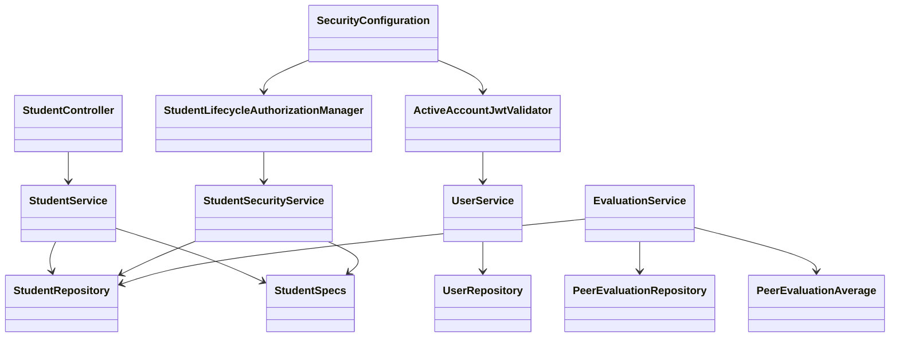
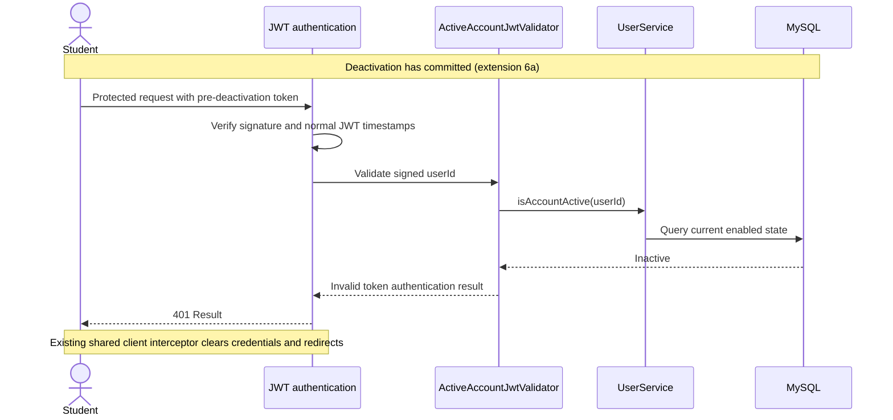

# Student Design

> Realizes: [UC-STU-deactivate-student](../requirements/use-cases.md#uc-stu-deactivate-student-the-course-admininstructor-deactivates-a-student).
> Depends on FRs: FR-SEC-active-account, FR-SEC-authorization, FR-SEC-deny-unauthorized ([security requirements](../requirements/software-requirements-specification.md#security-and-authorization-requirements)).
> Related flows affected: UC-EVA-submit-evaluation, UC-EVA-section-evaluation-report. Policy is owned by [business-rules.md](../requirements/business-rules.md).
> Architecture: [containers](architectural-design.md#containers), [foundation components](architectural-design.md#shared-foundation-components), and [Crosscutting Concepts](architectural-design.md#crosscutting-concepts). This is the approved design shape; implementation follows the merged design PR.

## Overview

Extend the existing student lifecycle path in the shared foundation, with supporting changes to authentication and performance tracking. The existing generic profile update is the starting point, not the completed dedicated action. Keep the existing shared domain model ([SRS](../requirements/software-requirements-specification.md#business-domain-model)); the dependencies and response conventions remain those of the architecture-of-record. The reactivation use case receives only the constraints recorded in its Associated Information; its existing implementation path is preserved.

## Components & classes

All components below are reused and extended except the two explicitly marked new. New methods live with their existing domain owner.

| Component | File / change |
|---|---|
| Student controller and service | [StudentController](../../backend/src/main/java/team/projectpulse/student/StudentController.java), [StudentService](../../backend/src/main/java/team/projectpulse/student/StudentService.java): dedicated action, scoped controller reader, transactional lifecycle operation, and generic-update bypass guard. |
| Student persistence and guard support | [StudentRepository](../../backend/src/main/java/team/projectpulse/student/StudentRepository.java), [StudentSpecs](../../backend/src/main/java/team/projectpulse/student/StudentSpecs.java), [StudentSecurityService](../../backend/src/main/java/team/projectpulse/student/StudentSecurityService.java): caller-derived lookup predicates and fail-closed permission checks. |
| Lifecycle route manager (**new**) | `backend/src/main/java/team/projectpulse/security/authorizationmanagers/StudentLifecycleAuthorizationManager.java`: read `studentId` through the existing `PathVariables` helper and delegate to `StudentSecurityService`. |
| Account validator (**new**) | `backend/src/main/java/team/projectpulse/security/ActiveAccountJwtValidator.java`: validate the signed identity against current account state; configured by [SecurityConfiguration](../../backend/src/main/java/team/projectpulse/security/SecurityConfiguration.java). |
| Shared account lookup | [UserService](../../backend/src/main/java/team/projectpulse/user/UserService.java), [UserRepository](../../backend/src/main/java/team/projectpulse/user/UserRepository.java): a fresh existence-and-enabled query by user ID. |
| Supporting course-section reads | [SectionService](../../backend/src/main/java/team/projectpulse/section/SectionService.java), [SectionRepository](../../backend/src/main/java/team/projectpulse/section/SectionRepository.java): scope the controller reader to its existing members or course owner. |
| Evaluation writes and reports | [EvaluationService](../../backend/src/main/java/team/projectpulse/evaluation/EvaluationService.java), [PeerEvaluationRepository](../../backend/src/main/java/team/projectpulse/evaluation/PeerEvaluationRepository.java), [PeerEvaluationAverage](../../backend/src/main/java/team/projectpulse/evaluation/PeerEvaluationAverage.java): guarded writes, owner-scoped edit lookup, current account status in report projection. |
| Student UI and API | [EditStudentForm.vue](../../frontend/src/pages/students/EditStudentForm.vue), [Students.vue](../../frontend/src/pages/students/Students.vue), [student API](../../frontend/src/apis/student/index.ts), [student types](../../frontend/src/apis/student/types.ts): dedicated action, confirmation, busy state, response message and existing list refresh. |
| Evaluation UI and API shape | [SubmitTeamsEvaluations.vue](../../frontend/src/pages/evaluations/SubmitTeamsEvaluations.vue), [SectionsEvaluations.vue](../../frontend/src/pages/evaluations/admin/SectionsEvaluations.vue), [evaluation types](../../frontend/src/apis/evaluation/types.ts): current eligibility filtering and current-status display. |



## Sequence

### Deactivate a student

```mermaid
sequenceDiagram
    actor Instructor
    participant UI as EditStudentForm
    participant Guard as Lifecycle authorization
    participant Controller as StudentController
    participant Service as StudentService
    participant DB as MySQL
    Instructor->>UI: View persisted student details (step 2)
    Instructor->>UI: Choose Deactivate (step 3)
    UI-->>Instructor: Warning and confirmation (step 4)
    alt Cancel or close (4a)
        UI-->>Instructor: Close warning; no request
    else Confirm (step 5)
        UI->>Guard: POST /students/{studentId}/deactivation
        Guard->>DB: Resolve caller scope
        alt Not permitted (1a)
            Guard-->>UI: 403 Result; no mutation
        else Permitted
            Guard->>Controller: Authorized request
            Controller->>Service: deactivateStudent(studentId)
            Service->>DB: Scoped lookup; lock and refresh student
            Service->>DB: Recheck scope before mutation
            alt Already inactive (6b)
                Service-->>Controller: Unchanged outcome
            else Active (step 6)
                Service->>DB: Set enabled=false; commit
                Service-->>Controller: Changed outcome
            end
            Controller-->>UI: 200 Result; outcome message
            UI-->>Instructor: Display result; close editor and refresh list
        end
    end
```

The service returns a changed/unchanged outcome, not an entity. Transaction completion precedes the controller's success response. An authorization failure found by the scoped service lookup also prevents both mutation and a successful no-op response.

### Existing session after deactivation



### Evaluation write after opening a form

```mermaid
sequenceDiagram
    actor Evaluator
    participant API as EvaluationController
    participant Service as EvaluationService
    participant DB as MySQL
    Evaluator->>API: Submit new evaluation or edit saved evaluation
    API->>Service: Converted input and URL evaluation ID for edits
    Service->>DB: Resolve target within caller's scope
    Note over Service,DB: Edits select the stored evaluation by URL ID and caller evaluator ID
    Service->>DB: Refresh managed evaluatee with PESSIMISTIC_WRITE
    alt Evaluatee inactive (EVA extension 9a)
        Service-->>Evaluator: 400 Result; no scores, comments or rows changed
    else Eligible and existing window checks pass
        Service->>DB: Save evaluation; commit and release student row lock
        Service-->>Evaluator: Existing success Result
    end
```

## API contract

Paths below are relative to `/api/v1`; all responses retain the shared `Result` envelope. The new action has no request body and returns `data: null`. Its messages distinguish "Student deactivated successfully" from "Student is already deactivated"; both are successful `200` responses.

| Endpoint | Caller / route rule | Request | Success | Errors and extension |
|---|---|---|---|---|
| **New** `POST /students/{studentId}/deactivation` | New `StudentLifecycleAuthorizationManager`; service independently scopes the target under BR-student-lifecycle | Target ID in path; no body | `200`, changed or unchanged message (step 6 / 6b) | `401` without valid active-account authentication; `403` for denied, missing or malformed target at route (1a); `404` if target disappears or leaves scope after the guard but before service lookup |
| `GET /students/{studentId}` | `anyOf(UserOwnershipAuthorizationManager, StudentLifecycleAuthorizationManager)` | Existing path | Existing Student DTO; preserve student self-read and admit the owning admin | Existing `401`/`403`; scoped reader returns `404` if target leaves scope after the guard |
| `PUT /instructors/sections/{sectionId}/default` | `anyOf(SectionMembershipAuthorizationManager, SectionOwnershipAuthorizationManager)` | Existing path/body | Existing response; owning admin can select the target course section | Existing `401`/`403`; preserve service check against caller's selected course |
| `GET /sections/{sectionId}` | `anyOf(SectionMembershipAuthorizationManager, SectionOwnershipAuthorizationManager)` | Existing path | Existing course-section DTO used to load report criteria | Existing refusal; service reader scopes existing members or course owner |
| `PUT /students/{studentId}` | Existing route authorization | Existing profile DTO | Existing profile edits and legacy reactivation | `400` if an instructor attempts active-to-inactive through this route, before any profile field changes; student self-update still ignores `enabled` |
| `POST /evaluations` | Existing authenticated route; caller identity from UserUtils | Existing peer-evaluation DTO | Existing response | Existing validation errors; `400` under BR-evaluation-active-evaluatee (EVA 9a) |
| `PUT /evaluations/{evaluationId}` | Existing evaluator-ownership manager and owner-scoped service lookup | Existing DTO and URL ID | Existing response | Existing ownership/window errors; `400` for inactive stored evaluatee (EVA 9a), even if body names someone active |
| `GET /evaluations/sections/{sectionId}/week/{week}` | `anyOf(SectionInstructorAuthorizationManager, SectionOwnershipAuthorizationManager)` | Existing course-section/week path | Existing report plus each average's current `enabled` field | Existing refusal; report service scopes the course section before querying students |
| `GET /evaluations/students/{studentId}/week/{week}/details` | `anyOf(StudentInstructorAuthorizationManager, StudentLifecycleAuthorizationManager)` | Existing student/week path | Existing detailed evaluations, preserving private-comment access rules | Existing refusal; scoped instructor/owner reader excludes students |

These supporting read-rule changes realize the same owning-admin scope on the existing report and prerequisite UI paths. Keep the ownership alternatives on these routes; do not broaden shared managers globally. Other single-student summary routes retain their existing behavior.

## Key decisions

- **Dedicated action:** reuse the editor's persisted student details, with a separate Deactivate button and `ElMessageBox` confirmation. Keep Deactivate available for initially active and inactive students, including an all-inactive roster; inactive targets follow the same confirmation and successful no-op path. Cancel, close and Escape send no action request. Confirm disables duplicate clicks until completion; response success uses the existing close-dialog/list-refresh path. The action uses the persisted target ID and does not save profile drafts. Rejected: saving a generic status toggle, which can bypass the warning and mix lifecycle changes with profile edits. The warning uses human-readable consequences from the cited rules and FR, never their identifiers.
- **Preserve ordinary edits:** the generic PUT guard applies only to callers who currently have the instructor authority to change `enabled`, when stored state is active and requested state is inactive. Evaluate it before changing username, names or email. Rejected: an unconditional `true -> false` guard, because a student's existing profile DTO can contain false or omit the primitive boolean, and the established self-update behavior ignores that field. Keep active-to-active and inactive-to-inactive profile edits and the legacy inactive-to-active path. For initially active students, replace the editor's status switch with read-only status; initially inactive students retain the existing enable path.
- **Two enforcement points:** the lifecycle guard and transactional mutation both use caller-derived ownership-or-assignment predicates. These are alternative grants: an admin of course A assigned as an instructor to course B qualifies through that assignment in B; an admin of A with no ownership or assignment in B does not. BR-section-scoped-access explicitly preserves these instructor capabilities. Use a left join or equivalent so an owning admin still matches a course section with no assigned instructors. The controller's scoped student reader also admits self-read; the lifecycle predicate does not. Keep the generic internal `findStudentById` unchanged for other callers. Rejected: binding a course-section manager directly to a student-only URL or relying on a role check alone.
- **Current account status per request:** compose the new validator with `JwtValidators.createDefault()` in the existing RSA decoder, retaining signature and expiry checks. Use a fresh `existsByIdAndEnabledTrue`-style query via UserService, not a cached entity or mutable `sub` username. Require a positive, integral, representable signed `userId`; malformed, missing, unknown and inactive identities fail authentication. This covers both student and instructor accounts under FR-SEC-active-account. Rejected: waiting for token expiry or adding a token blocklist; the former violates 6a, the latter adds persistent token lifecycle state this action does not need.
- **Save ordering:** both deactivation and evaluation writes refresh the managed target Student with `EntityManager.refresh(student, PESSIMISTIC_WRITE)` inside their service transaction, before any mutation, holding the same row lock through commit. A lock without refresh can leave the converter's earlier account state in memory. Resolve the target in scope first; creation rechecks current team eligibility after refresh, while editing owner-scopes the stored evaluation and uses its stored evaluatee and week. An evaluation completed before deactivation remains; one waiting behind committed deactivation is rejected. Rejected: an unlocked check followed by save, which can race. The refresh-and-lock operation is specified in the [Jakarta Persistence API](https://jakarta.ee/specifications/persistence/3.2/apidocs/jakarta.persistence/jakarta/persistence/EntityManager.html#refresh(java.lang.Object,jakarta.persistence.LockModeType)).
- **Relationship freshness:** after obtaining the student lock, make the final lifecycle authorization and create-time team comparison with current locking database reads. Neither cached course-section/instructor collections nor a transaction's earlier consistent-read snapshot supplies the decision. A permission or team change committed while a request waited is therefore observed before a mutation or no-op response. The MySQL tests below define this guarantee; query construction is an implementation detail.
- **One eligibility source:** fetch the current roster from existing `GET /students/teams/{teamId}` when loading the evaluation page, then filter both new forms and forms populated from previously saved evaluations by active teammate IDs. After a failed save, reload the roster and saved evaluations before rebuilding the forms; show the existing error rather than silently retrying. A form left open across deactivation may remain visible until that refresh, but both service write paths reject its stale submission. Keep the shared roster query unchanged for history consumers. Rejected: a UI-only filter or a global active-only roster query; each leaves either a direct-request bypass or missing historical rows. Polling or push updates are not required.
- **Projection, not history:** add `enabled` to PeerEvaluationAverage and its TypeScript interface, populate it from the current Student in `getPeerEvaluationAverage`, and show Active/Inactive under "Current account status" on the section report. Retain current team-based inclusion, score calculations, zero-value convention for no evaluations, and privacy behavior. Rejected: filtering inactive students out or adding a deactivation date; neither fits BR-evaluation-inactive-report.

## Data model

No table, column, migration or seed-data delta. Reuse the existing account flag and team relationship from the [performance-tracking domain](../requirements/software-requirements-specification.md#performance-tracking-domain). `PeerEvaluationAverage.enabled` is a response projection, not stored history. The row locks use the existing Student/user row and service transaction boundary; RAM's authoring locks are unrelated and are not reused.

## Reuse & cross-cutting

Reuse UserUtils, PathVariables, fail-closed authorization, the Result envelope, exception handlers, the shared request interceptor and the existing notification slice. SubmissionStatusService remains the source of obligations under BR-submission-owed; pin its behavior with regression tests rather than creating another definition. Existing calendar-window checks keep the injected Clock, while JWT timestamps keep real elapsed time.

The approved Level-1 delta is the Authentication note in `architectural-design.md`: signed token lifetime and current-account access are separate checks. Mark the account validator as designed but pending until implementation; update that note when the build installs it. Container boundaries and deployment stay as recorded.

## Tests

Each row is a stable review item. All levels are planned, not passing evidence. UI integration means Cypress with stubbed API responses; it complements the real backend integration tests. The build PR maps every row to named tests and names any uncovered row. Its confirmation screenshot and manual main-flow run are additional evidence.

| Flow / oracle source | Level | Asserts |
|---|---|---|
| Main: UC-STU-deactivate-student step 6 | Integration | Authorized action returns changed success and persists the disabled lifecycle state, with normal audit metadata where applicable and no unrelated profile changes. |
| Preservation: BR-student-lifecycle, BR-student-deactivation-team | Integration | Same account/course section/team; activity reports, evaluations, ratings and public/private comments unchanged. |
| No team: BR-student-deactivation-team | Unit + integration | An unassigned student can be deactivated without acquiring a team. |
| Repeated action: STU 6b / BR-student-deactivation-idempotent | Unit + integration | Successful already-deactivated message, no save or other mutation; works when no active student exists. |
| Warning race: STU 6b | Integration | A second actor deactivating after form display produces the same successful no-op on confirm. |
| Concurrent repeat: STU 6b | Integration using separate transactions | Second deactivation initially sees active state, waits for the first transaction's student lock, refreshes to inactive and returns unchanged without an extra save or audit mutation. |
| Owning admin: BR-student-lifecycle / STU step 2 | Integration | Owner unassigned to the course section can list/select it, search students, read the target and deactivate; include a course section with no assigned instructors. |
| Assigned instructor: BR-student-lifecycle | Integration | Assigned plain instructor succeeds; an admin of another course who is assigned here also succeeds through the instructor grant. |
| Refusals: STU 1a | Integration | Other-course admin with no target-course-section assignment, unassigned instructor and student self requests get 403 with account, team and work unchanged; unauthorized already-inactive requests also fail. |
| Reauthorization: STU 1a / Associated Information | Integration | Removing permission after showing the warning causes refusal at confirm, including already-inactive targets. |
| Relationship freshness: STU 1a / BR-team-scoped-access | Integration using separate transactions | Assignment removed while confirmation waits on the student lock causes refusal for active and already-inactive targets; a team change while create waits is also refused, even with earlier relationships managed in memory. |
| Scope defence: FR-SEC-authorization | Integration at service | Lifecycle lookup excludes another course/section independently of the route; scoped detail reader preserves student self-read without admitting self-deactivation. |
| Unresolvable target: architecture Authorization | Integration | Missing and malformed target IDs fail closed with uniform 403; absent credentials receive 401 and Result errors. |
| Cancellation: STU 4a | UI integration | Cancel, close icon and Escape each produce zero deactivation requests and leave persisted-state fixtures unchanged. |
| Warning / confirmation: STU steps 4-6 | UI integration | All chosen consequences appear; only Confirm sends POST; busy state prevents double clicks; success message and refreshed inactive status appear. |
| Initially inactive UI: STU PRE-2 / 6b | UI integration | With an all-inactive roster, target details still offer Deactivate; confirm produces the already-deactivated success path without enabling the target. |
| Existing token: STU 6a / FR-SEC-active-account | Integration | Obtain a real token while active, commit deactivation, reuse that exact unexpired token on a protected endpoint and receive 401. |
| Disabled login: FR-SEC-active-account | Integration | Correct Basic credentials cannot obtain a token after deactivation. |
| Validator identity: FR-SEC-active-account | Unit + integration | Missing, malformed, out-of-range, unknown or inactive user IDs fail; active student and instructor IDs work, including after a username change. |
| Authentication regression: FR-SEC-authentication | Integration | Active-user requests still work; invalid signatures and expired JWTs still fail; disabled instructor requests also fail. |
| Create eligibility: EVA 9a / BR-evaluation-active-evaluatee | Unit + integration | New evaluation of inactive teammate is refused with no insert; include direct POST and deactivation after opening the form. |
| Edit eligibility: EVA 9a / BR-evaluation-editable-until-close | Unit + integration | Stored inactive evaluatee is refused even when body names an active student or deactivation happened after the editing form opened; ratings, scores and both comments stay unchanged. |
| Save ordering: BR-evaluation-active-evaluatee | Integration using separate transactions | For both create and edit, deactivation holding the student lock makes the write wait, then fail after commit; an evaluation committed first remains intact. Include an already-managed evaluatee whose earlier enabled value was true. |
| Eligibility UI: EVA steps 2/7 and 9a | UI integration | New and loaded editing forms exclude inactive evaluatees; an inactive refusal triggers roster/evaluation reload and removes the stale form; existing saved evaluations remain in report fixtures. |
| Obligations: BR-submission-owed | Unit + integration | Inactive student owes neither item; active teammate who evaluated every active member owes nothing even without evaluating the inactive member. |
| Historical report: BR-evaluation-inactive-report | Integration + UI integration | Earlier requested week retains inactive student's row, stored score/comments and current Inactive status. |
| Later/empty week: BR-evaluation-inactive-report | Integration + UI integration | Later week without evaluations retains row and current Inactive label; it does not trigger section-report extension 5a. |
| Report access/privacy: BR-section-scoped-access, BR-evaluation-private-comment | Integration | Owning admin unassigned to the course section can load report criteria, report and details; unrelated admin and students cannot read instructor-only private details. |
| Generic bypass: dedicated STU action | Unit + integration | Instructor profile PUT requesting active-to-inactive returns 400 before changing any profile fields. |
| Profile compatibility: existing paths retained by design | Unit + integration | Student false/omitted-enabled self-update keeps enabled/roles; instructor active-to-active and inactive-to-inactive edits work; existing legacy inactive-to-active path still works. |
| Reactivation team constraint: UC-STU-reactivate-student Associated Information | Integration, existing PUT path | Reactivating after separate team removal preserves the then-current null team; no old assignment is restored. |
| Reactivation window constraint: UC-STU-reactivate-student Associated Information | Integration, existing PUT path | Reactivation does not permit creating or editing an evaluation for a closed week. |

## Implementation order & review

1. Shared trunk with targeted tests: account lookup/validator, caller-scoped lifecycle/read queries, generic PUT guard, shared locked evaluation guards and report projection. Stop after this commit for the student's explanation before building leaves.
2. Isolated security commit: install the validator, bind the dedicated lifecycle rule and the five supporting ownership alternatives in the contract table. Reuse fail-closed managers rather than broadening their shared behavior.
3. Leaf commits with targeted tests: controller action; student API/editor; evaluation-form eligibility; report status display. Run full suites once after the leaves, then map the traceability rows to actual artifacts and passing coverage.

## Open questions / risks

- No unresolved policy choice remains for this action. Requests already executing when deactivation commits are not retroactively cancelled; extension 6a governs subsequent protected requests.
- Account validation adds a database query per JWT authentication; latency and load are unmeasured. Lock waiting and transaction ordering require the planned MySQL integration test, not only mocks.
- The retained generic instructor inactive-to-active path can reactivate through a stale profile payload containing `enabled: true`. This existing reactivation limitation is not redesigned here; record it in the build review's Not verified section rather than claim it is solved.
- App execution, browser behavior, transaction ordering and mutation testing remain for the build PR. This design PR verifies documents and implementation completeness through the questions test.
